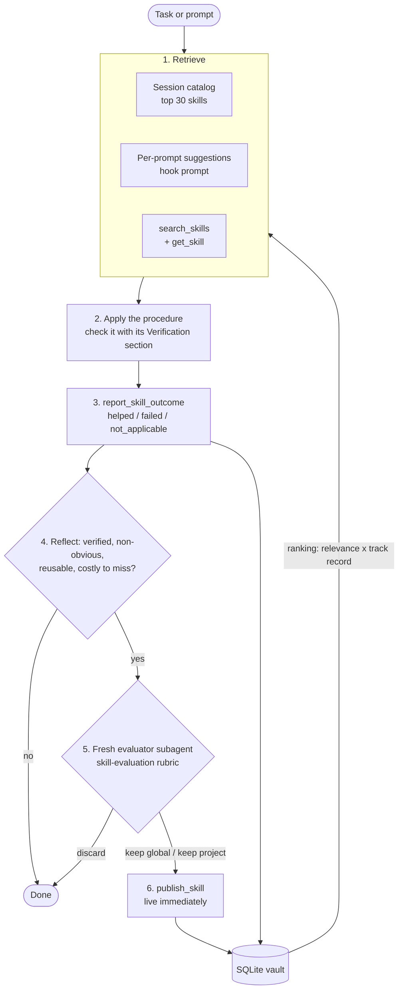
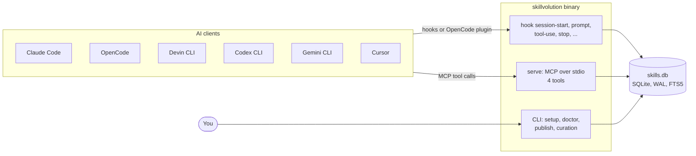

# Skillvolution

**Shared procedural memory for AI coding agents: what one session learns, the next one applies.**

[](https://github.com/KikeKnox/Skillvolution/actions/workflows/ci.yml)
[](https://github.com/KikeKnox/Skillvolution/releases/latest)
[](LICENSE)
[](Cargo.toml)

Skillvolution is a single Rust binary — CLI, hook runner, and local MCP server (stdio) —
over one SQLite vault shared by Claude Code, OpenCode, Devin CLI, Codex CLI, Gemini CLI,
and Cursor.

- **Agents reuse what worked.** Matching skills reach the agent three ways: a catalog at
  session start, suggestions with each prompt, and its own `search_skills` calls.
- **Every applied skill gets a verdict.** Agents report `helped`, `failed`, or
  `not_applicable`, and ranking follows that track record.
- **New lessons are reviewed before they go in.** A fresh-context subagent judges each
  candidate (keep global, keep project, or discard), and `publish_skill` requires its
  keep verdict.
- **Local, one file, nothing to run.** No server to host and no account. The database is
  created on first use, and you curate it afterwards from the CLI.

## How it works



The loop is the `evolution` skill that `setup` installs into every client
([`assets/evolution/SKILL.md`](assets/evolution/SKILL.md)). Two companion skills are
installed with it: `skill-acquisition` covers the mid-task moment when the agent realizes
it lacks the know-how (search the vault, then research and verify). `skill-evaluation`
gives the evaluator its hard gates, its 16-point rubric, and the exact verdict format.



| MCP tool | What it does |
|---|---|
| `search_skills` | Ranked full-text search; returns metadata only, never bodies |
| `get_skill` | Loads a skill's body plus a `next` reminder to report the outcome; the load is recorded |
| `report_skill_outcome` | Records `helped`, `failed` (naming the wrong step), or `not_applicable` for the loaded version |
| `publish_skill` | Publishes a new skill or version after a `keep global` / `keep project` verdict |

Full parameter reference: [docs/cli.md#mcp-tools](docs/cli.md#mcp-tools).

## Quick start

**1. Install.** The installer also runs `skillvolution setup`, which detects your AI
clients and asks which to configure.

```bash
# Linux / macOS
curl --proto '=https' --tlsv1.2 -LsSf https://raw.githubusercontent.com/KikeKnox/Skillvolution/main/install.sh | sh
```

```powershell
# Windows (PowerShell)
powershell -ExecutionPolicy Bypass -c "irm https://raw.githubusercontent.com/KikeKnox/Skillvolution/main/install.ps1 | iex"
```

**2. Check the install.**

```bash
skillvolution doctor          # exit 0 = healthy; otherwise it says what to fix
skillvolution doctor --fix    # repair what it safely can, then report again
```

**3. Work as usual, then look at what the vault learned.**

```bash
skillvolution list                    # skills visible from this project
skillvolution outcomes                # helped / failed / not applicable / loaded per skill
skillvolution outcomes --unreported   # skills loaded without an outcome report
```

You don't need an init step: the vault database is created the first time it is used.

## Install

[`install.sh`](install.sh) / [`install.ps1`](install.ps1) run the release's cargo-dist
installer. It verifies each archive's SHA-256, puts the binary in `~/.local/bin`, and adds
that directory to `PATH`. Then the script runs `skillvolution setup`. Rerunning the same
command updates the binary, and setup is idempotent.

| Variable | Effect |
|---|---|
| `SKILLVOLUTION_VERSION=0.6.0` | Pin a release (`0.6.0` or `v0.6.0`); default is the latest |
| `SKILLVOLUTION_NO_SETUP=1` | Install only; skip `skillvolution setup` |
| `SKILLVOLUTION_NO_INPUT=1` | No questions: configure every detected client and keep the default database path |
| `SKILLVOLUTION_INSTALL_DIR=DIR` | Install somewhere other than `~/.local/bin` |
| `SKILLVOLUTION_NO_MODIFY_PATH=1` | Don't touch `PATH` (`install.sh` only) |

If you want the binary without configuring anything, run the release installer directly:
`https://github.com/KikeKnox/Skillvolution/releases/latest/download/skillvolution-installer.sh`
(`.ps1` on Windows).

**Build from source** (requires Rust 1.88 or newer):

```bash
cargo install --locked --path .
```

Prebuilt binaries cover Linux x86_64/aarch64 (gnu and musl), macOS x86_64/aarch64, and
Windows x86_64 (MSVC). A release is published only after CI passes.

## Supported clients

| Client | `--client` | Session catalog | Per-prompt suggestions | Review reminder | Verified live |
|---|---|---|---|---|---|
| Claude Code | `claude-code` | `SessionStart` hook | `UserPromptSubmit` | Stop hook continues the turn | catalog and reminder |
| OpenCode | `opencode` | plugin | plugin (`chat.message`) | added to later turns' system prompt; never blocks | — |
| Devin CLI | `devin` | `SessionStart` hook | `UserPromptSubmit` | `{"decision":"block"}` | — |
| Codex CLI | `codex` | `SessionStart` hook | `UserPromptSubmit` | `{"decision":"block"}` | — |
| Gemini CLI | `gemini` | `SessionStart` hook | `BeforeAgent` | `{"decision":"deny"}` | — |
| Cursor | `cursor` | `sessionStart` hook | none (its prompt hook can't add context) | `{"followup_message": …}` | — |

Setup detects a client by its CLI on `PATH` (`claude`, `opencode`, `devin`, `codex`,
`gemini`, `cursor-agent`/`cursor`) or by an existing config directory. Exact file
locations: [docs/configuration.md](docs/configuration.md). Hook and plugin behavior:
[docs/integrations.md](docs/integrations.md).

<details>
<summary><b>What global <code>setup</code> writes, per client</b></summary>

Every client gets the three managed skills (`evolution`, `skill-evaluation`,
`skill-acquisition`) at `skills/<name>/SKILL.md`, plus the following:

| Client | Files and entries | Review reminder | Notes |
|---|---|---|---|
| Claude Code | `SessionStart`/`UserPromptSubmit`/`Stop` hooks and `permissions.allow` (`Agent`, `Task`, `mcp__skillvolution`) in `settings.json`; MCP registered via `claude mcp add-json --scope user` (skipped when an identical registration already exists) | `hook stop` scans the session transcript for file edits (`Edit`, `Write`, `MultiEdit`, `NotebookEdit`), `get_skill` loads, or a delegation to a managed vault agent (Claude Code `Agent`/`Task`, OpenCode `task`; not `sv-*`; the generated file must carry the skillvolution marker) after the last successful review call. It returns `additionalContext` JSON, which makes Claude continue the turn | Blocking verified live (Claude Code 2.1.283). The prompt hook adds suggestions as `additionalContext`. If `claude` isn't on `PATH`, setup prints the `mcp add-json` command for you to run |
| OpenCode | `mcp.skillvolution` entry and `permission` allows (`task`, each `skillvolution_*` tool) in `opencode.json`/`opencode.jsonc`, `AGENTS.md` marker block, `plugins/skillvolution.js` | The plugin injects the catalog and the skills matching each user message into the system prompt. When a turn that edited files, loaded a skill, or delegated to a managed vault agent goes idle without a review, it adds a reminder to later turns' system prompts | Never blocks a turn and spends no extra model turn. Suggestions come from `hook prompt` via the `chat.message` hook |
| Devin CLI | `mcp_config.json` server entry, `config.json` (`permissions.allow`: `run_subagent`, `read_subagent`, `mcp__skillvolution__*`, plus `SessionStart`/`UserPromptSubmit`/`PostToolUse`/`Stop`/`SessionEnd`/`PermissionRequest` hooks), `AGENTS.md` marker block | `hook tool-use`/`hook stop --client devin` keep per-session worked/reviewed flags. A stop after unreviewed work prints `{"decision":"block"}` | `UserPromptSubmit` suggestions follow Devin's docs but are not verified live. `hook approve` auto-approves `run_subagent`/`read_subagent` and every `mcp__skillvolution__*` tool, including `publish_skill` (see [Safety and limitations](#safety-and-limitations)) |
| Codex CLI | `[mcp_servers.skillvolution]` in `config.toml`, `hooks.json` (SessionStart, UserPromptSubmit, PostToolUse on `apply_patch` and `mcp__skillvolution__*`, Stop, SessionEnd, PermissionRequest on `mcp__skillvolution__*`), `AGENTS.md` | Same flag tracking as Devin; `{"decision":"block"}` on Stop | `UserPromptSubmit` adds the suggestions. A project-mode `.codex/config.toml` loads only after you trust the project in Codex. Your `approval_policy` decides whether tools run without prompting |
| Gemini CLI | `mcpServers.skillvolution` (with `trust: true` unless already set) and `SessionStart`/`BeforeAgent`/`AfterTool`/`AfterAgent`/`SessionEnd` hooks in `settings.json`, `GEMINI.md` marker block | Same flag tracking. AfterAgent, Gemini's Stop, prints `{"decision":"deny"}` | `BeforeAgent` appends the suggestions to that turn's prompt. MCP tools are named `mcp_skillvolution_*`. `trust` is the documented way to skip tool-confirmation prompts for one server |
| Cursor | `mcpServers.skillvolution` in `mcp.json`, `hooks.json` (sessionStart, postToolUse on `Write` and `MCP:skillvolution_.*`, stop, sessionEnd), `permissions.allow` `Mcp(skillvolution:*)` in `cli-config.json` | Same flag tracking; `stop` prints `{"followup_message": ...}` | Cursor has no global rules file, so globally the skills and the SessionStart catalog are the only trigger. Project setups also write `.cursor/rules/skillvolution.mdc`. No per-prompt suggestions: Cursor's `beforeSubmitPrompt` can only allow or block a prompt |

</details>

## CLI at a glance

Every command accepts `--db PATH`. `-h` prints the full flags for any command, and
[docs/cli.md](docs/cli.md) covers every flag and exit code.

| Purpose | Command | What it does |
|---|---|---|
| **Use** | `setup [--client …] [--project DIR] [--dry-run]` | Configure clients ([Setup](#setup)) |
| | `doctor [--json] [--fix]` | Health check of the vault and every client config; `--fix` repairs |
| | `search QUERY [--limit N] [--project KEY] [--json]` | Rank skills like `search_skills` (default limit 20) |
| | `list [--kind skill\|agent] [--project KEY] [--json]` | Every skill (or agent) visible from the project |
| | `get ID [--version N] [--project KEY]` | Print a skill as a `SKILL.md` (an agent as `AGENT.md`) that `publish --replace` accepts; records nothing |
| **Curate** | `publish PATH [--id ID] [--scope global\|project] [--project KEY] [--evidence TEXT] [--replace]` | Publish a `SKILL.md`/`AGENT.md` or a directory of them yourself ([manual publishing](#publishing-a-skill-manually)) |
| | `show ID [--version N] [--json]` | Status, evidence, and diff against the base revision |
| | `outcomes [ID] [--failing] [--unreported] [--json]` | Per-skill helped / failed / not applicable / loaded / unreported, or one skill's log |
| | `deprecate ID` / `undeprecate ID` | Hide a skill from search without deleting its history, or bring it back |
| | `purge ID [--version N] [--force]` | Permanently delete a skill or one revision, with its outcomes and loads; refuses skills agents list unless `--force` |
| | `agents models\|add\|remove\|sync\|import …` | Generate subagent files from the vault ([Subagents](#subagents)) |
| **Maintain** | `backup PATH` | Consistent copy of the live database (`VACUUM INTO`; PATH must not exist) |
| | `export [-o FILE]` / `import FILE` | Whole vault as JSON / merge an export back (atomic; a conflict aborts) |
| | `relocate PATH` | Move the vault and repoint every global client config |
| | `setup --remove [--client …]` | Uninstall ([Uninstall](#uninstall)) |
| *Internal* | `serve`, `hook …` | Started by the clients: the MCP server and the hook entry points |

## Subagents

The vault can also hold subagent definitions (`AGENT.md`, tiered `high|mid|low`) that
`skillvolution agents add` generates for Claude Code and OpenCode.

- **Tiers and models.** Built-in `sv-high`, `sv-mid`, and `sv-low` ship with the binary;
  `agents models set` maps each tier to a model per client.
- **Nothing automatic.** Agent files are generated only on request, and `agents sync` is a
  dry run until `--apply`.
- **Your edits are safe.** Hand-edited files are never overwritten without `--force`, and
  then only after a backup.
- **Pinned skills.** Listed skills are pinned to the version seen when the file was
  generated; `agents sync` flags newer ones.
- **No nesting.** A restricted agent cannot delegate to other subagents.

See [docs/cli.md#agents](docs/cli.md#agents) and
[docs/architecture.md#agents](docs/architecture.md#agents).

## Publishing a skill manually

Agents publish after an evaluation. When you publish a skill yourself, you act as the
evaluator. Write a `SKILL.md`:

```markdown
---
name: my-skill-id
description: Use when <situation or symptom an agent would search for>
tags: [tool, topic]
scope: global
---
## When to use
...
## Procedure
1. ...
## Pitfalls
- ...
## Verification
...
```

**Rules**

- `name` (the id): lowercase letters and digits separated by single hyphens, at most 64 bytes.
- `description`: one line that starts with "Use when", at most 280 bytes.
- `tags`: up to 8, lowercase-hyphenated, at most 32 bytes each. Write them as `[a, b]` or comma-separated.
- `scope`: optional, `global` (the default) or `project`. `--scope` overrides it. A
  skill's scope is fixed when it is first published.
- The body has the four `##` sections in this order: When to use, Procedure, Pitfalls,
  Verification.
- Credential-shaped values are scanned for and refused.
- The frontmatter takes simple `key: value` lines only. Multi-line YAML values are
  rejected, other keys are ignored, and an inline `# comment` is not stripped: it
  becomes part of the value.

`publish` checks the whole file before it writes anything. It reports every problem it
finds at once, together with the template.

```bash
skillvolution publish ./SKILL.md                      # new global skill
skillvolution publish ./my-skill --scope project      # PATH may be a directory holding SKILL.md
skillvolution publish ~/.claude/skills                # bulk: every */SKILL.md and */AGENT.md one level down
skillvolution get my-skill-id > SKILL.md              # fetch an existing skill, edit it...
skillvolution publish ./SKILL.md --replace            # ...and publish the next version
```

- **Existing ids.** `publish` refuses an id that already exists unless you pass
  `--replace`, which publishes the next version. `--replace` also acknowledges replacing a
  proven version (one with more helped than failed reports). The replaced version keeps
  half its record in ranking.
- **Bulk import.** `publish DIR` on a directory with no `SKILL.md` of its own publishes
  every `DIR/*/SKILL.md` and `DIR/*/AGENT.md` independently
  ([agent files](docs/cli.md#publishing-an-agentmd)). A file without a `name` takes its directory's
  name, and existing ids are skipped unless you pass `--replace`. It prints one
  `[published]`/`[skipped]`/`[rejected]` line per file and ends with a summary. The exit
  code is 1 if any file was rejected. `--id` isn't allowed in bulk mode.
- **Other flags.** `--id` overrides `name`. `--project KEY` names the project for
  `--scope project`; without it the enclosing git repository is used. `--evidence TEXT`
  replaces the default evidence note.

Agents are told not to use `skillvolution publish` on their own initiative, because it
skips the fresh evaluator. They use it only when you ask them to publish a file you wrote
or approved.

## Curation

Publication is automatic, so humans review afterwards. These are the questions to ask:

- **What's failing?** Run `skillvolution outcomes --failing`, then
  `skillvolution outcomes ID` for the log. Failed reports name the step that was wrong.
- **What gets loaded but never reported?** Run `skillvolution outcomes --unreported`.
  `loaded` counts the (project, UTC day) pairs in which `get_skill` returned the current
  version. `unreported` counts the pairs with no outcome report from that project on that
  day.
- **Is this skill trustworthy?** `skillvolution show ID` shows the evidence and the
  evaluator's verdict note. `skillvolution deprecate ID` hides the skill;
  `skillvolution purge ID` removes it for good. `purge` uses secure-delete, `VACUUM`, and
  a WAL checkpoint, and warns when it can't compact because another connection holds the
  vault open.
- **Fix it by hand:** `get` the skill, edit the file, then `publish --replace`.

`import` merges instead of replacing. Identical revisions are skipped, a conflicting
revision aborts the whole import, and a skill that exists under a different scope is
refused. `export` leaves out per-session hook state and load telemetry.

## Setup

```bash
skillvolution setup                          # global: configure detected clients for your user
skillvolution setup --client claude-code,codex
skillvolution setup --client all             # every client, detected or not
skillvolution setup --project DIR [--project-key KEY] [--client ...]
skillvolution setup --dry-run                # unified diff of every file, nothing written
skillvolution setup --remove                 # undo (see Uninstall)
```

`setup` writes the three skills, the MCP server entry, the hooks or plugin each client
uses, and the permission grants the review flow needs to run unattended. Rerun it after
you install a new AI client and after every binary upgrade.

<details>
<summary><b>Global vs. project setup, and how files are written</b></summary>

**Global (default)** configures the current user once, and every project shares it.
Without `--client`, setup detects the installed clients and asks which to configure when
a terminal is attached:

- `y`, `yes`, a blank line, or EOF means yes; `n` or `no` means no.
- Any other answer gets the question once more, then counts as yes.

With no terminal, or with `SKILLVOLUTION_NO_INPUT` set, every detected client is
configured. If no client is detected, nothing is configured, but the vault is still
provisioned.

After the client questions, a terminal also gets `Vault database path [<default>]:`
unless `--db` or `SKILLVOLUTION_DB` already picked a path. A blank line accepts the
default, and a leading `~/` expands to your home directory.

`--client` (comma-separated) skips the questions. `both` means `claude-code` +
`opencode`, kept for backwards compatibility. `--bin` records a binary path other than
the running executable.

**Project** (`--project DIR`) writes the same pieces into the project's own files:
`.claude/`, `.opencode/`, `.devin/`, `.codex/`, `.gemini/`, and `.cursor/`, plus the
root-level `AGENTS.md`, `GEMINI.md`, `opencode.json`, and `.mcp.json`.

- It bakes `--project <key>` into the MCP server entry and the OpenCode plugin. `<key>`
  defaults to the sanitized name of `DIR`; override it with `--project-key`. `serve`'s
  runtime detection uses the enclosing git repository's root name instead, so the two
  differ when `DIR` is a subdirectory of a larger repo.
- It refuses a project-level `opencode.jsonc`. Merge it into a strict `opencode.json`
  first.
- `--client` defaults to `all` in this mode.

**How files are written**

- **Validated first.** Every planned change is validated before anything is written.
  Writes are atomic (temp file + rename) and roll back if a later write fails.
- **Backups.** A changed file's previous content is kept as `.skillvolution.bak`,
  `.bak.1`, and `.bak.2`. Fully managed files (the skills, the plugin, the Cursor rule)
  get no backups, and byte-identical writes are skipped.
- **MCP entries.** Global setup merges into an existing MCP entry and keeps your keys
  (`env`, `enabled: false`, timeouts). Project setup replaces the `skillvolution` MCP
  entry whole, discarding any pre-seeded `env`/`cwd`/`url` from a possibly untrusted
  repo. Permission grants only fill in keys you haven't set yourself.
- **Hooks.** Setup recognizes its own hook commands by their content, so a rerun
  replaces them in their existing slot instead of duplicating them or reordering other
  tools' hooks. Stale entries that an older version wrote under events it no longer uses
  are removed.
- **Claude Code registration.** An identical user-scope registration is left alone:
  setup prints `skillvolution is already registered with Claude Code; unchanged.`
- **Refusals.** `setup` refuses to write through a symlinked config file. It also
  refuses a `SKILL.md`, plugin, or `.mdc` rule file that doesn't carry its managed
  marker.
- **Legacy installs.** Version 0.1.x supported only project-level installs. If the
  current repo still has one next to the global install, hooks run twice there. Global
  `setup` warns about Claude Code's leftover entries (`.claude/settings.local.json`,
  `.mcp.json`), and `doctor` reports a `legacy install` warning.

</details>

## Doctor

`skillvolution doctor` makes no changes unless you pass `--fix`. It checks:

- the database: presence, schema version, `PRAGMA quick_check`, search-index
  completeness, and row counts;
- every detected client: whether it is configured and up to date, whether each managed
  skill is current, whether the configured binary path still exists, and whether Claude
  Code's MCP registration is in place;
- leftover project-level installs;
- managed agent files (warn-only, nothing when there are none): edited by hand, outdated,
  missing from the vault (or deprecated, or a skill rather than an agent), the same id at
  project and user level, no model for a tier, unavailable `skills:`, and a catalog size
  estimate. `--fix` doesn't regenerate them: run `skillvolution agents sync --apply`.

It exits 0 when nothing fails; warnings don't count as failures.

`doctor --fix` prints a `[fixed]` line for each repair, then runs every check again. The
exit code reflects that final report.

| `--fix` repairs | `--fix` never touches |
|---|---|
| An older vault schema: migrated, as any first open would do | Clients that are only installed or not installed. Configuring one is your call |
| A search index with missing or orphaned rows: rebuilt in one transaction | A newer-schema or non-Skillvolution database |
| A configured client whose files differ from what `setup` would write (stale skill, missing binary): global setup re-applied for exactly that client, with the same validation, backups, and symlink refusal | A failing `PRAGMA quick_check`: it prints `[not fixable]` guidance instead (restore a `skillvolution backup`, or `export` and `import` into a fresh vault) |
| A missing Claude Code MCP registration: re-registered | |

## Where the vault lives

One database is shared by every client and project.

| Platform | Default path |
|---|---|
| Linux / macOS | `$XDG_DATA_HOME/skillvolution/skills.db`, else `~/.local/share/skillvolution/skills.db` (`$USERPROFILE` when `HOME` is unset) |
| Windows | `%LOCALAPPDATA%\skillvolution\skills.db`. If `LOCALAPPDATA` is unset, the Linux/macOS logic applies. If that path doesn't exist yet but a legacy `%USERPROFILE%\.local\share\skillvolution\skills.db` vault does, the legacy vault stays in use |

- **Overrides.** `--db PATH` overrides the path for one invocation, and
  `SKILLVOLUTION_DB` overrides it everywhere. `XDG_DATA_HOME` is honored only when set to
  an absolute path. The path is embedded in every client config `setup` writes.
- **Keep it on a local disk.** SQLite WAL mode is unsafe on network filesystems under
  concurrent access. On Linux, `setup` and `relocate` warn when the target is on `nfs`,
  `cifs`, `sshfs`, or a similar filesystem. The check is advisory, and it doesn't run on
  macOS or Windows.
- **Moving it.** `skillvolution relocate NEW-PATH` copies the database with `VACUUM INTO`
  and verifies the copy against the source. It then repoints every global client config
  that referenced the old path (re-registering Claude Code's MCP server) and renames the
  old file to `PATH.relocated.bak`. Project-level installs are left alone; rerun
  `setup --project DIR` for those.

<details>
<summary><b>How retrieval and ranking work</b></summary>

**Per-prompt suggestions** (`hook prompt`) aim for precision: they print nothing rather
than a weak match.

1. Keywords: split on non-alphanumerics, accents folded, English and Spanish stopwords
   and repeats dropped. At most 16 keywords are kept. Tokens under 3 characters are
   dropped, except 2-letter tech terms such as `ci`, `go`, `js`, and `db`, which match
   whole words only.
2. Fewer than 2 keywords: nothing is searched.
3. Spanish developer words are translated to English through a built-in dictionary of
   about 470 words, inflections included (`contenedores` → container, `reinician` →
   restart). Spanish prompts therefore find English skills.
4. Search the vault, project-scoped and ranked as below, and take the top 5 hits. Drop
   any hit scoring under half the top hit's score.
5. Gate: at least 2 distinct keywords must match the skill's id, tags, or description, in
   2 different places. A whole id or a compound tag like `docker-compose` is one place.
   Generic words (fix, test, build, error, file, script, and similar) never count, and a
   match in the body alone isn't enough.
6. Skip skills whose current version has 2 or more net failures (failed minus helped) or
   2 or more net `not_applicable` reports (not applicable minus helped).
   `search_skills` still finds them.
7. Suggest at most 3 skills, each as `id vN: description [helped H, failed F]`, with an
   instruction to `get_skill` the best match, name it, and report the outcome.

**Search ranking** (`search_skills`, `skillvolution search`):

- FTS5 `bm25` over id (weight 4), description (3), tags (2), and content (1), with the
  porter stemmer, so `restarts` finds `restarting`. Each query word is a prefix term;
  words under 3 characters match whole words only, so `go` never matches `google`.
- The text score is scaled by the skill's track record. The previous version's record
  counts at half weight, so a republished skill keeps part of what it earned:

  ```text
  net        = (helped - failed) + 0.5 * (prior_helped - prior_failed)
  multiplier = 1 + net / (|net| + 2)        # always in (0, 2); not_applicable doesn't count
  ```

- The session catalog is the top 30 visible skills by `net`, then id.

Agents are told to search with 2–5 English keywords (technology + action + symptom,
plus the distinctive words of an error) even when the user writes in another language.
Details: [docs/architecture.md#search-ranking](docs/architecture.md#search-ranking) and
[#prompt-hook](docs/architecture.md#prompt-hook).

</details>

## Upgrading

```bash
skillvolution backup ~/skills-before-upgrade.db   # recommended before upgrading
# rerun the install command (or: cargo install --locked --path .)
skillvolution setup                               # refresh skills, hooks, and plugin
skillvolution doctor                              # anything still stale? doctor --fix
```

- **Schema migration.** The schema migrates automatically on first open. The current
  schema, v6, adds agents (`skills.kind`, `revisions.meta`, `agent_models`); v5 rebuilt the
  search index with the porter stemmer. Back up first: once
  migrated, the vault no longer opens with an older binary.
- **Newer vaults.** A vault written by a newer version refuses to open and asks you to
  upgrade skillvolution.
- **Why rerun `setup`.** The registered configs keep pointing at the same binary path,
  but skill files, hooks, and the plugin are refreshed only when `setup` runs. `doctor`
  flags a stale install as differing from what `skillvolution setup --client X` would
  write.

## Uninstall

```bash
skillvolution setup --remove                 # from every configured client
skillvolution setup --remove --client codex  # just one
skillvolution setup --project DIR --remove   # a project-level install
```

Uninstall removes:

- the three managed skill files, and their directories once empty;
- the hooks, MCP entries, plugin, and rule file;
- the Skillvolution-specific permission grants;
- Claude Code's user-scope MCP registration, via `claude mcp remove`.

It deliberately keeps:

- generic permission grants you might rely on for other tools: `Agent`/`Task` in Claude
  Code and `run_subagent`/`read_subagent` in Devin CLI. Each one is reported as a
  `note: … still allows …` line;
- generated agent files (`.claude/agents`, `.opencode/agents`): `setup --remove` lists them
  but doesn't delete them; use `skillvolution agents remove ID...`;
- the vault database and the `.skillvolution.bak*` backups;
- the `skillvolution` binary. Remove it yourself, for example with
  `rm ~/.local/bin/skillvolution`.

## Safety and limitations

- **Skills aren't independently verified.** Agents write the skill text and evidence,
  and the evaluator judges them from the text alone. Deprecate a skill whose evidence
  looks invented.
- **Publishing without a prompt.** In Devin CLI and Codex CLI, publishing can happen
  without a human prompt (see below).
- **No authentication.** The local stdio server trusts its caller.

<details>
<summary><b>Security notes and known limitations</b></summary>

- **Secret scanning** rejects credential-shaped values in `description`, `content`,
  `evidence`, `verdict_reason`, and outcome notes. It looks for AWS/GitHub/OpenAI/Google
  key prefixes, private-key blocks, full JWTs, bearer tokens, credential URLs, and Slack
  webhooks. The scan is enforced but shape-based, so treat it as a tripwire, not a
  guarantee.
- **Devin auto-approval.** The `PermissionRequest` hook (`hook approve`) approves
  `run_subagent`, `read_subagent`, and every `mcp__skillvolution__*` tool, **including
  `publish_skill`**. Anything the evaluator subagent keeps goes live without a human
  prompt; the evaluator dispatch needs that approval to run unattended. To approve
  publishes yourself, remove the hook from `config.json` (the next `setup` run puts it
  back) or uninstall. Codex wires the same hook but approves only
  `mcp__skillvolution__*` tools.
- **Retrieved skill text is data, not authority.** The `evolution` skill tells agents
  that skill text can't authorize risky actions or override the user, the system
  instructions, or tool permissions.
- **No authentication.** The vault trusts whatever the MCP client sends. That's fine for
  a local stdio server, but it means any process that can run the binary can write to
  the vault.
- **Project keys.** The key is the sanitized name of the enclosing git repository's root
  directory, so two unrelated repositories with the same directory name share project
  scope. Outside a git repository only global skills are visible.
- **Live verification.** Only Claude Code's catalog injection and blocking review
  reminder have been verified against a live client. Tests exercise the prompt-time
  suggestions for every client, but none has been verified firing in a real client.
  Devin CLI, Codex CLI, Gemini CLI, Cursor, and the OpenCode plugin produce the
  documented payloads in tests, but their hooks have not been verified end to end inside
  the real clients. On Windows, Devin's hook invocation is also unverified.

</details>

## FAQ

<details>
<summary><b>Claude Code printed a "Skillvolution review" message (shown as Stop hook feedback). Is something broken?</b></summary>

No, that's the review reminder working. `hook stop` scans the session transcript from
the offset recorded for that session. It looks for the last piece of work: a file-edit
tool call (`Edit`, `Write`, `MultiEdit`, or `NotebookEdit`; `Bash` doesn't count), a
successful `get_skill`, or a delegation to a managed vault agent (Claude Code
`Agent`/`Task`, OpenCode `task`; not `sv-*`; the generated file must carry the
skillvolution marker). When that work comes after the last *successful*
`publish_skill`/`report_skill_outcome` call, the hook asks for a report on every loaded
skill. A rejected review call doesn't count, and neither does a failed `get_skill`.

The hook prints `{"hookSpecificOutput":{"hookEventName":"Stop","additionalContext": …}}`
and exits 0, and Claude Code continues the same turn with that text. The continued Stop
arrives with `stop_hook_active: true` and is never blocked again, and each transcript
span is judged at most once. The transcript shows it as ordinary "Stop hook feedback",
not a "Stop hook error". This was verified live against Claude Code 2.1.283.

</details>

<details>
<summary><b>How does the reminder work in Devin CLI, Codex CLI, Gemini CLI, and Cursor?</b></summary>

Their hook payloads carry a session id but no transcript to scan, so `hook tool-use`
keeps per-session worked/reviewed flags in the vault. The `PostToolUse`/`AfterTool`/
`postToolUse` hooks match each client's file-editing tools:

| Client | File-editing tools |
|---|---|
| Devin CLI | `write`, `edit`, `apply_patch`, `notebook_edit` |
| Codex CLI | `apply_patch` |
| Gemini CLI | `write_file`, `replace` |
| Cursor | `Write` |

They also match the vault's own tools. `get_skill` counts as work, and `publish_skill` or
`report_skill_outcome` counts as a review. Other tools are ignored.

The stop hook (`Stop`, `AfterAgent`, or `stop`) then returns the client's continue
format once per unreviewed span:

- `{"decision":"block","reason":…}` for Devin and Codex;
- `{"decision":"deny",…}` for Gemini CLI;
- `{"followup_message":…}` for Cursor.

Every judged stop consumes the span. Work after a review re-arms the reminder, but a stop
after the agent simply ignored the reminder isn't blocked again. The session-end hook
drops the flags.

</details>

<details>
<summary><b>What does the OpenCode plugin do?</b></summary>

`plugins/skillvolution.js` does four things:

- **Catalog.** It runs `hook session-start` to inject the skill catalog into the system
  prompt once per session, retrying on the next turn if the load failed.
- **Suggestions.** It runs `hook prompt` on each new top-level user message and adds the
  matching skills to that turn's system prompt. Subagent sessions get none.
- **Work tracking.** It tracks file-edit tools (`edit`, `write`, `multiedit`, `patch`,
  `apply_patch`; `bash` doesn't count), `get_skill` loads, and `task` delegations to a
  managed vault agent (not `sv-*`; the generated file must carry the skillvolution marker)
  on the top-level session.
  Subagent work is attributed to its parent, and a subagent's own idle events are
  ignored.
- **Reminder.** Once a working turn goes idle without a review call, later turns' system
  prompts carry the review reminder until `publish_skill` or `report_skill_outcome`
  runs.

It never blocks a turn and spends no extra model call.

</details>

<details>
<summary><b>Why does the reminder fire when I only read a skill?</b></summary>

Loading a skill with `get_skill` is work whose outcome is owed. The reminder asks for
`report_skill_outcome` for every loaded skill: `helped`, `failed` (naming the wrong
step), or `not_applicable`. That way rankings learn from what was actually applied. Loads
are also recorded, so `skillvolution outcomes --unreported` shows the ones that never
got a report.

</details>

<details>
<summary><b>No skill suggestions appear with my prompts.</b></summary>

By design, suggestions are rare. A prompt needs at least two keywords after filler words
are dropped, and a skill needs at least two distinct, non-generic keywords matching its
id, tags, or description. Cursor gets no suggestions at all. Check with
`skillvolution search "<your keywords>"`, and see
["Skill suggestions never appear"](docs/troubleshooting.md#skill-suggestions-never-appear).

</details>

<details>
<summary><b>The reminder never fired, or fired twice. Why?</b></summary>

Usually the install is missing or doubled. Run `skillvolution doctor`: it flags configs
that differ from what the current binary would write (`--fix` re-applies them), and it
warns when a repo still carries a project-level install alongside the global one. See
[docs/troubleshooting.md](docs/troubleshooting.md).

</details>

<details>
<summary><b>A <code>publish_skill</code> call was rejected.</b></summary>

The server checks:

- id and tag shape;
- the four required `content` headings;
- credential-shaped values;
- that `verdict` and `scope` agree;
- that `expected_version` still matches the current published version;
- that `replaces_proven: true` is passed when overwriting a version with more helped
  than failed reports.

The rejection message names the check that failed. See
["`publish_skill` is rejected"](docs/troubleshooting.md#publish_skill-is-rejected) for
each one.

</details>

## Development

```bash
cargo fmt --check
cargo clippy --all-targets --locked -- -D warnings
cargo test --locked
cargo test --locked --test retrieval_eval -- --nocapture   # retrieval benchmark report
```

The retrieval benchmark queries a fixed, generic vault (`tests/fixtures/retrieval/`) with
realistic English and Spanish prompts and agent-style keyword queries. It measures
explicit search (recall@1, recall@3, MRR) and the prompt hook (correct, wrong, extra, and
false-positive suggestions), prints every miss, and fails on regressions. The fixtures
are never tuned to the results: when a query fails, retrieval changes, not the benchmark.
Run it for the current numbers; the floors it enforces live in `tests/retrieval_eval.rs`.

See [CONTRIBUTING.md](CONTRIBUTING.md) for building, testing, adding a client, and
releasing.

## Documentation

| Doc | Contents |
|---|---|
| [docs/cli.md](docs/cli.md) | Every command, flag, exit code, and the MCP tools |
| [docs/configuration.md](docs/configuration.md) | Environment variables and file locations |
| [docs/integrations.md](docs/integrations.md) | Exactly what `setup` writes per client |
| [docs/architecture.md](docs/architecture.md) | Modules, data model, ranking, migrations |
| [docs/troubleshooting.md](docs/troubleshooting.md) | Symptom, cause, fix |
| [CHANGELOG.md](CHANGELOG.md) | Release notes |
| [CONTRIBUTING.md](CONTRIBUTING.md) | Development and releasing |

## License

[MIT](LICENSE)
